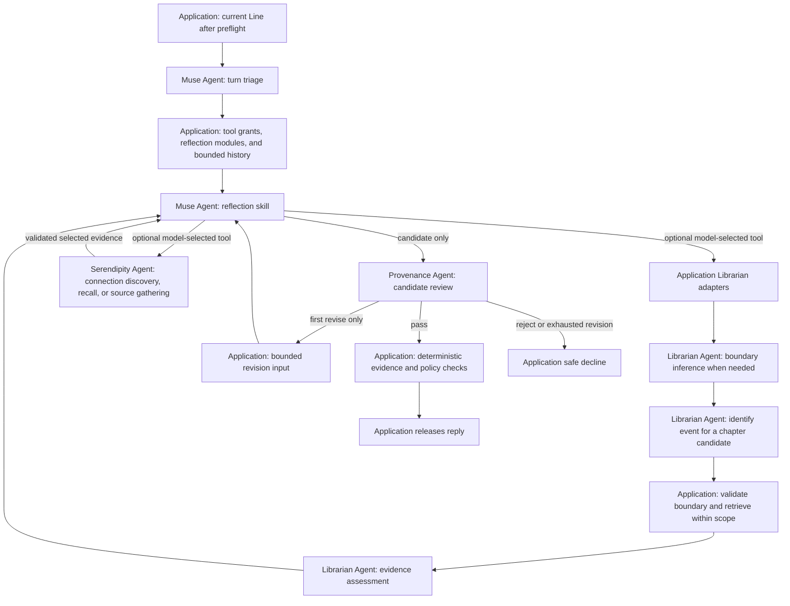
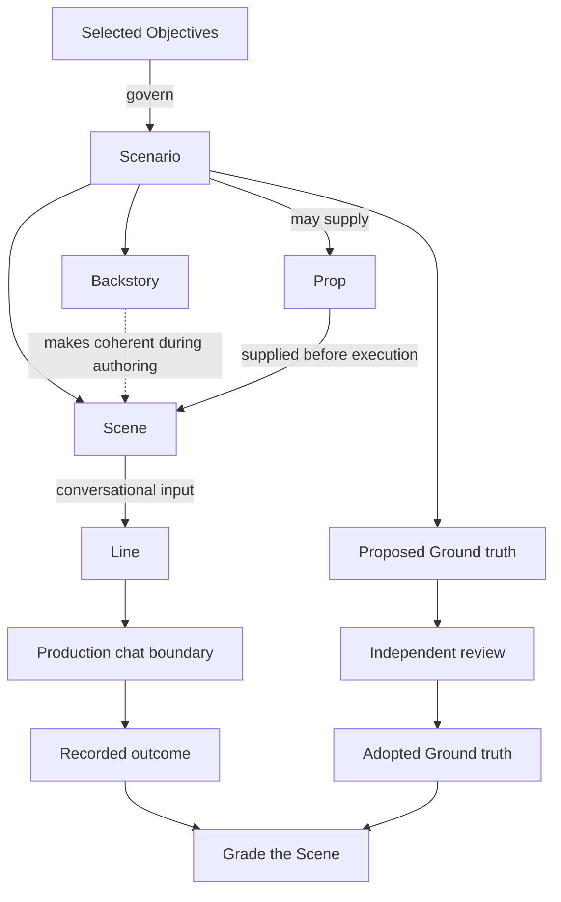

# Linger: System Specification

Status: **Draft implementation specification**

This document is the canonical source for product scope, architecture,
authority rules, and acceptance criteria. It states what must hold and who
enforces it. The submitted project proposal remains an immutable PDF under
`docs/submissions/`. Report sources are kept in
[Sources for the Final Project Report](report-sources.md).

**Editing rule.** Add rules, authority boundaries, and acceptance criteria here.
Put mechanisms, thresholds, field lists, commands, and runner behaviour in the
owning design doc, agent README, or evaluation guide, and link to it. Each
section's **Detail** line names that doc.

**Implementation status.**

- Implemented: the typed Muse candidate with the complete reply, evidence uses,
  and `MemoryCandidate | NoMemoryCandidate`; Provenance review of reply and
  nomination; deterministic capture; capture-triggered curation
  ([§4.2.5](#425-capture-triggered-curation-and-offline-surfacing)).
- Offline only: Sculptor memory surfacing. Chat never runs it.
- Target only: image evidence and Muse-declared sensitive-inference flags.
  Provenance already reviews sensitive inference and vetoes sensitive content in
  automatic capture.

## Contents

1. [Purpose and positioning](#1-purpose-and-positioning)
2. [Product hypothesis and journey](#2-product-hypothesis-and-journey)
3. [Prototype scope](#3-prototype-scope)
4. [Architecture and authority](#4-architecture-and-authority) ·
   [4.1 Output release contract](#41-output-release-contract) ·
   [4.2 End-to-end flows](#42-end-to-end-flows)
5. [Core records](#5-core-records)
6. [Safeguards](#6-safeguards) · [6.1 Spoilers](#61-spoilers) ·
   [6.5 Verification](#65-verification) · [6.6 Emotional content](#66-emotional-content)
7. [Evaluation and acceptance](#7-evaluation-and-acceptance) ·
   [7.2.1 Canonical vocabulary](#721-canonical-vocabulary)
8. [Operations and change control](#8-operations-and-change-control)
9. [Recursive self-improvement](#9-recursive-self-improvement)

## 1. Purpose and positioning

Linger is an academic prototype of a personal reflection and memory companion,
grounded initially in a small literary corpus. It helps a user articulate why
an idea or experience mattered, preserve it as a structured memory, and later
explore grounded, tentative connections across conversations, books,
photographs, and evidence found through general web search.

Linger is not another general personal agent. It is a **provenance-first
reflection companion** that keeps the user's words, source evidence, and
generated interpretation distinct. Before any Muse-generated response reaches
the user, Provenance, a separate model call, reviews the complete draft for
quotations, factual claims, sensitive inferences, attribution, privacy, spoiler,
and prompt-injection risks. Application code then runs deterministic checks. A
non-factual reflection may pass without retrieval, but never without review.

The corpus is five Project Gutenberg works, all enabled by default for chat
retrieval and Reader: *Alice's Adventures in Wonderland*, *Animal Farm*, *The
Adventures of Pinocchio*, *Narrative of the Life of Frederick Douglass*, and
*The Story of My Life*. Configuration grants access to exact book revisions.
Chapter-based and section-based works share the permission rules in
[§6.1](#61-spoilers). This small, older corpus may contain dated cultural
perspectives.

**Detail:** [corpus format guide](corpus/canonical-sections.md),
[book registration](book-registration.md).

## 2. Product hypothesis and journey

Linger tests whether a reflection companion becomes more useful and trustworthy
when it can:

1. help the user articulate why a fragment mattered;
2. preserve that reflection with inspectable provenance;
3. retrieve exact supporting passages without crossing a spoiler boundary; and
4. reconnect the reflection to later experiences without inventing meaning or
   becoming intrusive.

| Stage | Required behaviour |
|---|---|
| **Reflect** | Muse drafts responses to text or a photograph and asks a few useful follow-up questions. Provenance reviews every complete draft before display, including drafts with no declared factual claims. |
| **Ground** | Librarian retrieves authorised book passages. Muse separates quotations, user statements, and generated interpretation; Provenance checks the draft and its claimed support. |
| **Preserve** | Muse may nominate a reflection for automatic capture. Provenance may veto it, and only the deterministic Memory & Policy Service commits it. A later curation run may ask Sculptor for one action, which needs its own Provenance verdict ([§4.2.2](#422-reviewed-memory-capture-and-curation)). There is no memory-management drawer or explicit save, correction, or deletion. |
| **Reconnect** | Muse may ask Serendipity to explore a cue across memories, books, and web evidence. Muse drafts the tentative connection, and Provenance reviews it before release. |

Automatic capture is on by default for interactive accounts. A stored account
policy outranks the default, and controlled evaluation sets capture as
server-side state. Every capture still needs a Muse nomination, no Provenance
veto, and deterministic policy approval. Content about sensitive traits is never
captured.

## 3. Prototype scope

### 3.1 In scope

- ongoing Muse conversations using text and user-supplied photographs, with
  semantic Provenance review of every candidate response;
- cited retrieval across the registered literary corpus and reviewed release of
  selected personal-memory evidence;
- keyword, semantic, hybrid, fusion, and reranked retrieval strategies;
- request-specific spoiler filtering and deterministic quotation validation;
- reviewed automatic memory capture, with a visible notice for any committed
  capture and an account policy that controls whether capture is permitted;
- saved reader-confirmed chapter progress per account and work, reused only
  after the work is identified for the current turn;
- immutable original memories, versioned generated summaries, duplicate links,
  topic groups, reversible retrieval tombstones, and progressive disclosure;
- conversation- or photograph-triggered connections using internal evidence and
  optional general web search;
- cross-book connections across confirmed books, each bounded by its own
  reading permission;
- capture-triggered memory curation
  ([§4.2.5](#425-capture-triggered-curation-and-offline-surfacing)), with
  memory surfacing evaluated offline only;
- a mandatory, context-restricted output gate, deterministic post-checks, at
  most one revision, and an application-authored safe decline;
- a simple web interface, multiple test accounts, CI/CD, and reproducible test
  deployment;
- adversarial, output-gate, reflection, retrieval, memory-quality,
  connection-quality, cost, and latency evaluation;
- offline, owner-reviewed retrieval-improvement experiments, plus proposed
  failure-to-eval promotion and a Sculptor-curated system playbook
  ([§9](#9-recursive-self-improvement)).

### 3.2 Stretch

- voice-note transcription, including audio-borne prompt-injection tests;
- memory-to-memory and song-to-memory connections;
- comparison of a revisited pairing with an earlier reflection; and
- a synthetic exercise of an opt-in feedback pipeline.

### 3.3 Out of scope

- automatic reading-progress measurement or a dedicated reading-progress
  management interface;
- live music, photo-library, messaging, or social integrations;
- the full Project Gutenberg catalogue;
- copyrighted books, lyrics, or copyrighted-audio analysis without permission;
- general shell, browser-control, or external-action capabilities;
- continuous monitoring or unsolicited resurfacing outside an active user
  conversation, including notifications;
- end-user memory-management settings and explicit save, review, correction, or
  deletion controls;
- mental-health profiling, diagnosis, or risk assessment. The fixed
  crisis-resource pointer in [§6.6](#66-emotional-content) is a narrow
  exception, not general crisis-resource routing;
- autonomous prompt or skill self-modification. The loops in
  [§9](#9-recursive-self-improvement) produce human-reviewed proposals only;
- production scale, availability, compliance, or regulatory claims; and
- any claim that prototype telemetry measurably improved the system.

## 4. Architecture and authority

The system contains five reasoning agents and one deterministic service:

| Component | Responsibility | Write authority |
|---|---|---|
| **Muse** | Maintains the reflection conversation, handles photographs and spoiler clarification, routes work, and produces candidate responses that cannot be sent directly to the user. Its typed output may nominate one `MemoryCandidate` or return `NoMemoryCandidate`. | None |
| **Librarian** | Judges request-scoped reading boundaries and the strength of supplied evidence. Application services select candidates, enforce scope, fuse results, and rerank evidence. | None |
| **Sculptor** | Curates bounded sets of existing memories while preserving originals. Offline tasks judge memory surfacing, propose chapter cues, analyse retrieval failures, and research retrieval specifications. A scheduled system-playbook task remains a proposal ([§9.2](#92-sculptor-curated-system-playbook)). | Proposals and decisions only |
| **Serendipity** | Searches internal and optional web evidence and proposes or declines tentative connections. | None |
| **Provenance** | Runs a no-tool emotional-boundary preflight before Muse, then reviews every complete Muse candidate. Separately reviews Sculptor curation proposals against their exact sources and returns `allow`, `revise`, or `reject` bound to the proposal digest. | None |
| **Memory & Policy Service** | Derives account scope and deterministically enforces capture and curation policy, access, storage, idempotency, source freshness, audit verification, and the retrieval projection. Accepts only reviewed commands whose proposal digest matches an `allow` verdict. | Commits validated writes |

**Account scope.** The Memory & Policy Service derives account identity from
the authenticated request, never from model output. No agent can choose or widen
account scope.

**Product surface.** The web application exposes sign-in, Muse conversation,
saved conversation history, new chats, and conversation deletion. It exposes no
Reader, Inspect, Serendipity payloads, memory-management UI, or public memory
CRUD API. The local development frontend may mount Reader and Inspect
([§4.2.4](#424-developer-corpus-and-inspection-tools)).

**Tool implementation policy.** Use an
[official Pydantic AI tool or capability](https://pydantic.dev/docs/ai/tools-toolsets/common-tools/),
a provider-native tool supported by Pydantic AI, or a supported external toolset
such as MCP. A custom function tool is allowed only for a Linger-specific domain
operation with no maintained implementation, such as account-scoped memory
retrieval or the spoiler boundary. Custom tools are thin adapters over
application services. They must not reimplement search clients, page fetching,
schema generation, dispatch, or retries.

The allowed tool surface is deliberately smaller than each agent's
responsibility:

| Agent | Allowed tools or capabilities | Implementation source |
|---|---|---|
| **Muse** | No general-purpose tools. Photographs use model input support. Muse may call only the `librarian_route`, `librarian_search`, and `serendipity_explore` tools the application grants for the turn. The application owns their grants, scope, execution, validation, and release. Memory nomination is part of Muse's typed output. | Pydantic AI multimodal input, typed outputs, thin Linger function-tool adapters |
| **Librarian** | No model tools. Boundary inference receives privately selected candidates from the work's numbered main-text chapters. Evidence assessment receives a bounded evidence set. Application code owns retrieval and record resolution. | Typed model tasks over application-selected evidence |
| **Sculptor** | No tools, except offline retrieval research, which can call `web_search` and `get_page` over public technical sources. No task has write authority. | Pydantic AI typed contracts; research-only `ResearchSearch` over Exa |
| **Serendipity** | Searches the account's active memories and internal book evidence through bounded Linger adapters; searches and opens public web pages with Exa. Each source is granted per request. | Linger adapters plus [`pydantic_ai_harness.exa.ExaSearch`](https://pydantic.dev/docs/ai/tools-toolsets/common-tools/#exa-search-tool) |
| **Provenance** | No tools. Each gate receives only its typed input; see [§4.1](#41-output-release-contract). | Pydantic AI typed input and output contracts |

Exa is the only web-search integration. Register `ExaSearch()` from the
`pydantic-ai-harness[exa]` extra in Serendipity's capabilities. Do not add a
local Exa client or the deprecated `exa_search_tool`, Exa common tools, or
`ExaToolset`. Exa results are untrusted evidence under [§6.4](#64-untrusted-content-and-privacy)
and [§6.5](#65-verification). This does not authorise browser control, arbitrary
URL fetching, shell access, or any external action excluded by [§3.3](#33-out-of-scope).

**Runtime skills.** Each role owns one reusable PydanticAI `Agent`. The
application selects one assigned skill before each run; the model never
discovers skills. All roles use `LINGER_MODEL` for main tasks. Muse turn triage
uses the provider's small model: `gpt-6-luna` for OpenAI, `gemini-2.5-flash` for
Google, and `LINGER_MODEL` for Anthropic.

| Role | Assigned runtime skills | Current consumers |
|---|---|---|
| Muse | Reflection; turn triage | Drafts and one revision return `MuseCandidate`. The no-tool triage call returns `TurnNeeds`, which decides the turn's tool grants. |
| Librarian | Boundary inference; event identification; book request; evidence assessment | Chat routing and bounded retrieval; retrieval benchmarks and replay. |
| Sculptor | Memory curation; memory surfacing; chapter cues; retrieval error analysis; retrieval research | Reviewed curation, offline surfacing, and owner-reviewed retrieval experiments. Chat never invokes surfacing or research. |
| Serendipity | Connection discovery; memory recall; source gathering | Muse's `serendipity_explore` tool, which selects the skill by intent, and component evaluation. |
| Provenance | Emotional preflight; candidate review; curation review | Chat preflight and candidate review; the curation loop. |

**Context separation.** Muse keeps the application-managed session history and
bounded revision context. Other roles receive only task-specific projections.
Each hand-off is a strict, discriminated envelope with only the fields the next
step needs. Full transcripts are never passed between agents. Prompts never load
repository development instructions or treat reader content, memories,
retrieved evidence, or model candidates as instructions.

Provenance shares no working context with other agents. It independently
detects quotations, factual claims, and sensitive inferences instead of
trusting Muse's declarations. Its curation gate has no Muse context and echoes
the exact proposal digest. This is separation of duties, not model
independence, because the same underlying model may be used.

**Detail:** [agent runtime skills](agent-skills.md) (skills, modules, digests,
tool exposure), agent READMEs under `src/linger/agents/`.

### 4.1 Output release contract

Every reply reaches the reader through one of these release sources. Each row
says who decides and what happens on failure.

| Step | Owner | Rule | On failure |
|---|---|---|---|
| Emotional preflight | Provenance, backstopped by a deterministic self-harm match | Runs on the current Line before Muse or any tool ([§6.6](#66-emotional-content)). `continue_reflection` enters the Muse flow. `apply_boundary` and `apply_self_harm_boundary` release a fixed reply as `application_emotional_boundary`. | Preflight failure returns the application safe decline before Muse runs |
| Muse candidate | Muse | Returns the complete reply, evidence uses with `supported_claims`, and a memory nomination ([§5.4](#54-muse-candidate-response)). Declarations are review hints, not authority. | Output validation rejects empty or stale spans |
| Candidate review | Provenance | Audits every claim mapping, every uncovered or quoted span the application projects, and the whole reply for omitted claims. Returns `pass`, `revise`, or `reject`, plus an independent `allow_capture` or `reject_capture`. | One `revise` allows one revision; reject or failed revision returns the safe decline |
| Evidence resolution | Application | Resolves every declaration against the request-scoped evidence indexes ([§5.3](#53-evidence-record)) and checks quotations, locations, citations, account scope, and reading scope. | Unsupported, ambiguous, or changed evidence returns the safe decline |
| Capture | Memory & Policy Service | Commits only a released Muse candidate with `allow_capture` that passes policy ([§4.2.2](#422-reviewed-memory-capture-and-curation)). | Write refused; reply still released |

**Book evidence.** The book index accepts only exact records from the current
direct Librarian result, the selected records of a current Serendipity
proposal, or records re-resolved from identifiers cited by an earlier released
reply in the same session. A re-resolved record authorises only that exact
passage. It grants no reading progress or neighbouring text. New records must
match the current validated book scope.

**Memory and web evidence.** `canonical_connection_evidence` gives Provenance
the exact request-owned records. Memory records must match the account's
active-memory snapshot. Web records must match a page opened from an exact
application-supplied URL or a lead from the current run. A nonempty URL
allowlist excludes all other pages; an empty one excludes every page. Page
requests pass the privacy checks in [§6.4](#64-untrusted-content-and-privacy).
Web uses need exact Markdown URL citations. Personal memories support
attributed personal context, not public factual claims.

**Weak searches.** An empty, weak, or failed direct Librarian search describes
that search only. It does not invalidate validated evidence from another
permitted search or a selected Serendipity proposal. Each claim must be judged
against the evidence that actually supports it.

**Capture suppression.** The reply and capture decisions are independent: a
capture veto does not block a safe reply. Storage also requires a released Muse
candidate. Every `application_safe_decline` suppresses capture
(`safe_decline_capture_suppressed`), even after `allow_capture`. Every
emotional-boundary release records `emotional_boundary_capture_suppressed`.

**Revision.** The second review receives `previous_response_review` and returns
one `finding_resolutions` entry per earlier finding. Unresolved findings
prohibit approval. The reviewer still checks the whole revised reply, and the
earlier review grants no evidence or reading authority. Each locatable finding
requires a change to a sentence it identifies. Retained unflagged wording must
stay exact and keep valid source mappings.

**Detail:** [Muse review and release](../src/linger/agents/muse/README.md#review-and-release)
(sentence labels, repair checks in `claim_repair.py` and `labels.py`),
[Provenance inputs and decisions](../src/linger/agents/provenance/README.md#two-independent-decisions).

### 4.2 End-to-end flows

#### 4.2.1 Reflection and grounding

After preflight returns `continue_reflection`, Muse asks Librarian for evidence
only when grounding is needed. Every Muse path produces a candidate for
Provenance review; there is no Muse-to-user bypass. The only no-Muse branches
are the fixed emotional boundary and the safe decline after a preflight failure
([§4.1](#41-output-release-contract), [§6.6](#66-emotional-content)).

The diagram shows the logical flow inside `run_chat_turn`. HTTP requests and
synthetic Scenes enter the same boundary.

Repeated role labels are runs of the same reusable object. Retrieval is
application code.

**Detail:** [skill and authority diagrams](agent-skills.md#authority-and-run-context),
[Provenance flows](../src/linger/agents/provenance/README.md#provenance-flows).

#### 4.2.2 Reviewed memory capture and curation

**Capture.** Muse may nominate one `MemoryCandidate`. Provenance may veto it for
privacy, sensitive inference, unsupported provenance, or injection risk. The
Memory & Policy Service derives account scope, checks account policy and
idempotency, and owns every write. Independently of Provenance, it refuses
storage when the candidate text contains a credential. Email addresses and phone
numbers are already redacted at chat entry ([§6.4](#64-untrusted-content-and-privacy)).
The application reports a committed capture but offers no management action.

**Curation.** Sculptor is not part of capture. Curation is the callable
`run_curation_loop` service. Chat invokes it only after a new durable capture
([§4.2.5](#425-capture-triggered-curation-and-offline-surfacing)).

1. The service resolves 2–12 memory identifiers to immutable originals within
   the authenticated account.
2. Sculptor receives those originals with their capture dates and the existing
   derived records wholly inside the batch. It has no tools and returns one
   `CurationProposal | NoCurationProposal`. Event dates must come from the text,
   not the capture date.
3. Application code snapshots every referenced original and hashes the account
   scope, curation-state digest, proposal, and source digests into an immutable
   `CurationPlan`.
4. The curation Provenance gate receives the digest, proposal, and exact source
   evidence, and returns `allow`, `revise`, or `reject` echoing the digest. Any
   other outcome stops the flow.
5. Only an exact `allow` produces `ApprovedCuration`. The service re-reads the
   originals, fails closed on stale, unknown, cross-account, or invalid sources,
   screens proposed summary and label text, and appends one idempotent audit
   event.
6. The service verifies the stored event and source hashes. Retrieval reads the
   materialised curated view.

Allowed actions are duplicate links, versioned derived summaries, topic groups,
retrieval tombstones, and restoration. A tombstone needs a prior duplicate link
to a distinct original that is still retrievable, so opposite tombstones cannot
hide both duplicates. Tombstones and restoration change only retrieval; no
action changes or deletes a source record. There is no public memory CRUD
endpoint, physical deletion, or autonomous scheduler.

**Detail:** [memory format design](design/memory-format.md),
[Provenance curation review](../src/linger/agents/provenance/README.md#curation-review).

#### 4.2.3 Connection discovery and verification

Serendipity supplies a proposal or decline to Muse. Muse drafts the reply, which
goes through the same Provenance gate and release checks as any reflection.

- **Grant.** The application grants `serendipity_explore` when the reader has a
  confirmed book, permitted web reach, or any active memory. The application,
  not Muse, supplies the current reader message as the cue.
- **Sources.** Serendipity may search the curated memory view, granted book
  scope, and granted Exa web sources. Memory search uses lexical token overlap,
  so a heavily paraphrased cue can miss a relevant record.
- **Intents.** Connection discovery returns a proposal needing two distinct
  supported connections, or a decline. `recall_memory` searches memories only
  and returns one to three exact records or `no_matching_memory`.
  `gather_sources` returns an unranked bundle of every source the reader named,
  plus any it could not find.
- **Budget.** Each run is limited to 16 model requests and 14 tool calls.
- **Validation.** Application code validates selected records against their
  grants. Book records enter the book evidence index; memory and web records
  enter the connection evidence index. Losing candidates are discarded.
  Content-bearing diagnostics are not returned by the API. Image evidence is
  unsupported.

Muse grounding and Serendipity book search share one judged retrieval
operation. Librarian plans separate book needs, each is searched within the
same trusted scope, and evidence assessment returns `sufficient` only when every
need is supported. Retrieval or judge failure returns no evidence. This shared
contract never widens reading scope.

**Detail:** [Serendipity README](../src/linger/agents/serendipity/README.md),
[Librarian retrieval and evidence strength](design/librarian-design.md#44-retrieval-fusion-and-deduplication).

#### 4.2.4 Developer corpus and inspection tools

Reader and Inspect are developer and debugging tools, not product surfaces. A
user-facing frontend must not expose them or depend on their state.

- **Reader** browses the enabled books read-only. Navigation and summary reveal
  are local state and never establish reading progress, session evidence, or
  retrieval permission.
- **Inspect** is a read-only projection of each completed turn: contracts,
  context resolution, agent statuses and timing, Provenance verdict path,
  release source, failure stage, and capture outcome. Ordinary records exclude
  Serendipity payloads, web or private evidence, rejected drafts, Provenance
  critiques, and memory content.
- **`LINGER_DEV_INSPECT=true`** attaches full content traces to later turns. It
  is for local development and demos only and must never be enabled for a
  deployment real readers use.
- **Progress streaming.** `POST /api/chat/stream` sends allowlisted, content-free
  progress metadata, then the complete response after release checks. Progress
  metadata never contains draft text.
- **Guided conversations and persona replay** help developers exercise the
  corpus and saved evaluation runs. They have no adopted Ground truth and make
  no model calls in replay.

None of these tools can authorise retrieval, release, capture, or storage.

**Detail:** [chat and developer tools](../apps/README.md#chat-and-developer-tools),
[persona export](../apps/frontend/README.md).

#### 4.2.5 Capture-triggered curation and offline surfacing

Application code owns when curation runs and which evidence Sculptor receives.
Curation changes the retrieval view and grants Sculptor no tools, writes, or
release.

1. A natural Line describes a changed preference without asking to save. The
   normal preflight, Muse nomination, Provenance review, and capture policy
   apply.
2. Only a successful new durable capture triggers curation. The application
   supplies the new original and relevant earlier originals through the bounded
   selection contract. An idempotent retry is not a new change.
3. Sculptor proposes a supported action or no change, which must pass the
   curation Provenance gate before the service applies and verifies it. A
   revision, rejection, or failed validation authorises no write. A failure
   cannot be reported as successful curation. No change is a valid outcome.

If capture is absent, vetoed, suppressed, or fails, no curation runs. A curation
success never authorises a response.

Memory surfacing is offline only. Chat never runs Sculptor surfacing, and Muse
receives no surfacing hand-off. Replies may use memories returned by
Serendipity under the ordinary release checks. The offline surfacing runner
([§7.2.2](#722-objective-selection-and-downstream-boundary)) evaluates
Sculptor's `surface_now`, `defer`, and `do_not_surface` decisions.

## 5. Core records

### 5.1 Session state

Working context contains only:

- server-supplied `account_id`;
- `memory_capture_enabled`;
- the request-scoped `spoiler_boundary` ([§6.1](#61-spoilers));
- the reader's latest declared chapter for the active work and part, held for
  the session;
- exact book records re-resolved from identifiers cited by earlier released
  replies in this session; and
- a bounded suffix of released conversation history: at most eight recent turns
  and 16,000 characters, dropping whole oldest turns.

The complete memory archive is never injected into every prompt.

**History.** Released Muse replies and application clarifications enter
conversational history. A safe-decline turn enters as the reader's message
paired with the fixed decline text, so a correction in a declined message still
reaches later turns. Muse's rejected draft is never stored. Emotional-boundary
and language-boundary turns keep only a content-free record. Each turn also
keeps a content-free record of release source, cited evidence identifiers, and
finding codes, with no passage text or reading progress.

**Persistence.**

| State | Where | Survives |
|---|---|---|
| Accounts and tokens | `data/accounts.sqlite3` | Restart |
| Released replies, clarifications, inspection records | `data/transcripts.sqlite3` | Restart; removed by conversation deletion |
| Saved chapter progress | `LINGER_STATE_DIR/reading_progress.sqlite3` | Restart and conversation deletion |
| Book selection, inferred boundaries, unit and passage permissions, tool history, evidence handles | Process memory | Nothing |

Boundary replies and safe declines are not saved as transcript turns. A restored
transcript supplies conversational context but its reader statements are
excluded from boundary inference.

**Concurrency and retries.** One operation may be active per session;
overlapping turns and deletions receive a conflict. Retrying a saved turn with
the same client turn ID and normalised message returns the persisted response
without another agent run. A different message under that ID receives a
conflict. A stored request fingerprint allows this without keeping the reader's
unredacted contact details.

### 5.2 Memory record

An active memory belongs to the requesting account and was captured through the
reviewed automatic-capture path. Each contains:

- stable `memory_id` and server-supplied `account_id`;
- the user's original words;
- cited source-evidence identifiers, when applicable;
- a generated summary stored separately from the original;
- provenance linking the originating conversation or photograph;
- links to related, duplicate, or parent memories;
- an idempotency key derived from account, source event, and capture type;
- derivation metadata for generated records; and
- created and updated timestamps.

Originals are immutable. Sculptor may add versioned derived summaries and links
but cannot modify an original. A retrieval tombstone changes only the
materialised view and is not deletion.

Captures are stored as Markdown files with JSON front matter under the
Git-ignored `memories/<hashed-account-id>/`. Curation events are immutable JSON
under `memories/<hashed-account-id>/curation/`, recording the allowed review,
digests, action, source snapshots, and curation-state digest. Replaying an
identical plan is idempotent; conflicts or stale state fail closed. The
retrieval projection combines visible originals with the latest derived records
and excludes only tombstoned originals. No vector database or search-index layer
exists until retrieval requires one.

**Detail:** [memory format design](design/memory-format.md).

### 5.3 Evidence record

Every retrieved item carries:

- stable evidence identifier;
- source type and source location;
- owner or account scope where applicable;
- trust level and verification state;
- spoiler position for book evidence; and
- the minimum excerpt required for the current task.

During one request, exact book records live in a read-only map keyed by evidence
identifier, fed by the three sources in [§4.1](#41-output-release-contract).
Conflicting records for one identifier fail closed. A separate request-only
index holds selected memory and web records. Both are discarded after the
request; session state keeps only released handles. Neither tool output nor
Muse's declaration can expand them.

### 5.4 Muse candidate response

`MuseCandidate` contains `reply`, `evidence_uses`, and `memory`.

| Evidence use | Declares | Checked against |
|---|---|---|
| `book_corpus` | Evidence ID, source location, optional exact quotation | Canonical record; quotation must occur in record and reply |
| `memory` | Evidence ID, optional exact quotation | Account's active-memory snapshot |
| `web` | Evidence ID, optional exact quotation, plus exact Markdown URL citation in the reply | Opened page |
| `session_line` | Exact earlier reader wording | Retained reader Lines from successful turns in this session |

At target completion, a candidate also carries declared claims,
sensitive-inference and policy flags, and revision metadata. All declarations
and the memory nomination are untrusted review hints. They never narrow what
Provenance inspects or what application code validates.

### 5.5 Memory candidate

An automatic `MemoryCandidate` contains only:

- the user's original words proposed for capture;
- the source turn and evidence identifiers, when applicable;
- a concise nomination reason; and
- sensitive-inference and policy flags.

`NoMemoryCandidate` contains a machine-checkable reason code. Neither type
contains account scope or write authority. There is no explicit-save path.

### 5.6 Connection proposal

`ConnectionProposal` is Serendipity's pre-review decision. It contains a ranked
shortlist of two or three candidates, each with a tentative claim, evidence
identifiers, shared structure, meaningful difference, interpretation, and the
`cue_fit`, `reflective_value`, and `safety` rubric. It also names the selected
candidate, qualitative uncertainty, a suggested follow-up, and whether the
winner cites web evidence. It contains no Provenance verdict. Muse treats it as
untrusted internal material.

**Detail:** [Serendipity proposal and decline](../src/linger/agents/serendipity/README.md#proposal-and-decline).

## 6. Safeguards

### 6.1 Spoilers

A reading permission names a work, its immutable revision, and a literary part,
then either a completed chapter ceiling or exact named units. Chapter ceilings
cover only numbered chapters in that part. Prefaces, letters, and other named
sections have no chapter number; completing one permits only that unit. These
rules govern retrieval, cached indexes, connection searches, citation
validation, and final release.

**Where permission comes from.**

| Source | Grants | Persists |
|---|---|---|
| Reader's explicit completion statement or clarification answer | Chapter ceiling | Session carry; saved per account and work after release |
| Saved progress | Reader-confirmed ceiling, only once the work is identified this turn | Account |
| Librarian inference supported by a relevant memory | Request-scoped ceiling | Never |
| Earlier reader statements describing reading a scene | Exact requested paragraphs only ([session passages](design/session-passage-design.md)) | Never |
| Current Line alone, curiosity, or hearsay | Nothing; clarification required | — |

**Raising and lowering.** Only application code writes progress, and inference
never raises it. A lower declaration applies at once, even if the turn fails. A
higher declaration applies only after its turn is released. Any other turn that
may speak to progress retracts the carried ceiling and fails closed. Selecting
another book or part clears the carry. Saved progress never selects a work.

**Routing.** Muse calls `librarian_route` only when the reader's words show the
request depends on a book; an active session book alone is not enough. The
application supplies the exact reader message. A deterministic registry
resolves titles and aliases. Weak catalogue words cannot select a work or expose
a memory. Multiple plausible works produce a clarification before boundary
inference.

**Boundary inference.** Librarian searches the selected work's numbered
main-text chapters privately, with the current Line and up to eight routed
memories, and returns a content-free candidate ceiling. It must never return
post-boundary story content to Muse. Application code validates the work,
revision, memory and evidence IDs, and basis. A Line-only candidate, confidence
below `0.75`, conflicting context, missing support, retrieval failure, or an
invalid decision produces an application clarification. A separate
event-identification run, without memories, must agree on the stopping point.

**Enforcement.** Answer retrieval is a separate search clamped to the validated
ceiling. Application code rejects evidence outside it before Muse sees it.
Exact-passage grants do not enable Serendipity book search or persist progress.

**Cross-book comparison.** When the reader has confirmed two or more books, a
connection request searches each at its own confirmed ceiling. A book the reader
has not declared is never searched.

**Clarification.** Unresolved routing or boundary questions are released as
`application_clarification` after Provenance passes, and suppress capture. A
chapter-only reply counts as progress only while a clarification is pending.

**Detail:** [Librarian routing, boundary, and progress](design/librarian-design.md#41-book-identity-and-contextual-routing)
(retraction cues, precedence, clarification follow-ups, cache identity),
[session-supported exact passages](design/session-passage-design.md).

### 6.2 Citations and attribution

Application code verifies every displayed or stored book quotation's text,
source, and location against the canonical record in the request-scoped index.
Memory and web declarations use their separate index, and web uses need exact
Markdown URL citations. Neither can satisfy a book-corpus declaration. Image
evidence is unsupported. Muse separates evidence from interpretation, and
Provenance reviews every draft for undeclared or mislabelled quotations and
claims.

### 6.3 Memory and media control

- Automatic capture is on by default for interactive accounts. A stored account
  policy outranks the default; controlled evaluation sets it server-side.
- Every committed capture produces a visible notice without a management action.
- Before a long capture-enabled evaluation conversation is compacted or closed,
  Muse may make one final nomination through the same review and policy path.
- The interactive application has no save, review, correction, or deletion
  controls.
- Raw photographs remain transient. Derived memories from photographs may be
  captured only while controlled capture policy is enabled.
- Sensitive-trait content is never captured automatically.
- A safe decline or emotional-boundary release never commits memory or produces
  a save notice ([§4.1](#41-output-release-contract)).
- Logs and telemetry follow the [telemetry data contract](telemetry.md).

### 6.4 Untrusted content and privacy

Book text, web results, photographs, media descriptions, and candidate model
responses are untrusted input. Instructions inside evidence never gain tool
authority.

| Boundary | Check | Result |
|---|---|---|
| Chat entry (`validate_user_input`) | DataFog regex `EMAIL` and `PHONE` | Redacted before agents or storage. Names, addresses, employers, and health conditions are not redacted |
| Chat entry | Detected credential | Turn blocked before the pipeline |
| After the language guard | Three fixed rules: instruction overrides, hidden-instruction requests, replacement instructions | Safe decline before any agent. Blocked message enters no history and commits no progress |
| Every provider request (`ProviderCredentialGuard`) | Credentials in messages, tool history, instructions, schemas | Request blocked |
| Replies, curation text, session, transcript, and memory writes | Credentials | Blocked |
| Web queries and page requests | Shaped personal data, secrets, and copied reader or memory wording | Request blocked |

Injection rules scan only the current reader message, not memories, book
passages, or web excerpts. Provenance's semantic review still checks untrusted
content. Public web queries must use general concepts, never private wording.
Evidence supplied to each agent is minimised, account-scoped where applicable,
and labelled by trust level.

**Detail:** [security guardrails](implementation/provenance-security-validation-guardrails.md),
`src/linger/contracts/security_validation.py`,
[Serendipity deterministic validation](../src/linger/agents/serendipity/README.md#deterministic-validation)
(copied-wording overlap rules).

### 6.5 Verification

Every Muse candidate needs a recorded approving Provenance verdict before
release. Provenance may pass, reject, or request one revision. A candidate is
not released when:

- cited evidence is missing or unresolved;
- attribution is incorrect;
- the spoiler boundary is unclear;
- evidence crosses account boundaries;
- a factual web claim lacks a retrievable citation;
- it contains an unsupported claim or sensitive inference;
- it violates the emotional-content policy;
- retrieved content attempts to redirect agent behaviour;
- it complies with a reader attempt to override the companion's instructions or
  role;
- it is toxic, dangerous, sexually explicit, hateful, or harassing, rather than
  declining and redirecting to reflection on the reading;
- it claims or implies being human, having feelings, a body, memories of a
  personal life, or personal reading experiences, or fosters emotional
  dependence by positioning itself as a substitute for people in the reader's
  life;
- it gives individualised medical, legal, financial, or therapeutic advice or
  instructions, rather than declining and returning to the reading;
- it performs a task unconnected to reflection on the reader's reading, the
  sources and images they bring, their remembered notes, or their own life.
  Reflection on the reader's experiences, feelings, relationships, and decisions
  is in scope with or without a book; or
- it reveals, quotes, or paraphrases its own instructions, loaded skills, tool
  names or schemas, or internal review process.

Rejected and superseded drafts are never displayed. Deterministic validation
runs after semantic approval and fails closed to the safe decline. A finding
coded `spoiler`, `prompt_injection`, `policy_override`, `harmful_content`, or
`instruction_disclosure` requires `response_decision="reject"`, not a revision.
Capture findings independently determine `capture_decision`.

**Detail:** [Provenance risk taxonomy](../src/linger/agents/provenance/README.md#risk-taxonomy).

### 6.6 Emotional content

Linger is a reflection companion, not a wellbeing tool. It never diagnoses or
labels a person's mental state. A distressing disclosure is a current,
first-person Line that communicates intense distress or inability to cope, so
that continued reflective questioning would be inappropriate. Ordinary
disappointment, frustration, uncertainty, literary discussion, or concern about
someone else does not trigger it. This is a request-local interaction boundary,
not a diagnosis, severity score, or crisis assessment.

The no-tool Provenance preflight sees only the current Line and the versioned
emotional-content policy. For a distressing disclosure, the application returns
exactly:

> That sounds deeply distressing. I don’t want to keep probing, and I’m not able
> to assess your wellbeing. Please consider reaching out to someone you trust or
> a qualified professional for support.

A first-person disclosure of wanting to kill or harm oneself is a distinct
decision, `apply_self_harm_boundary`, with its own fixed response:

> Thank you for telling me. I’m not able to assess your safety or support you
> through this, so please reach out to someone who can: a person you trust, a
> doctor, or a crisis line. If you’re in immediate danger, contact your local
> emergency services. You can find a crisis line for your country at
> https://findahelpline.com.

A small deterministic pattern set backstops this decision. A matched
first-person self-harm or suicide statement applies the self-harm boundary
whatever the model returns. It does not fire on literary or third-person
discussion.

On either boundary, Muse, Librarian, and Serendipity do not run, and no
candidate, evidence, nomination, write, or save notice exists. A preflight
failure returns the generic safe decline. As defence in depth, the candidate
gate reports a missed boundary through `emotional_boundary_decision=required`
and a current-Line `emotional_policy_violation`, and the application substitutes
the canonical response without a revision. Inspection records whether the
boundary came from preflight or candidate review. Surfacing the crisis-resource
pointer on a self-harm disclosure is the sole exception to the
mental-health exclusion in [§3.3](#33-out-of-scope).

### 6.7 Request rate limiting

Each authenticated account may make at most 10 chat requests per rolling 60
seconds, checked before preflight or any agent. `POST /api/chat` and
`POST /api/chat/stream` share the budget, and changing the session ID does not
reset it. A refused request receives `429`, a fixed message, and `Retry-After`;
refused attempts do not extend the wait. Counters live in the serving process,
reset on restart, and are not shared across processes. Each agent run also has
fixed request or tool-call limits.

### 6.8 Message normalisation

The reader's message is normalised once at ingestion, before history, prompts,
capture binding, detectors, or inspection read it. Normalisation removes
control characters, invisible characters, and lone surrogates, keeps joiners
only where scripts need them, and applies NFC (not NFKC) so capture can quote
the reader's exact typed text. The length and emptiness checks run afterwards.
Detectors run on a further-folded copy that is never stored or shown.

**Detail:** [message normalisation](implementation/provenance-security-validation-guardrails.md#message-normalisation).

### 6.9 English-only reader message guard

Linger reads and replies in English only. After normalisation and before the
emotional preflight, a deterministic, model-free guard checks whether the
message is confidently not English. If so, no agent runs, no capture occurs, and
the application returns exactly:

> Linger can only read and reply in English right now. Could you rephrase
> your message in English?

The self-harm detector ([§6.6](#66-emotional-content)) takes priority: on a match
the language guard is skipped. The guard is biased toward false negatives and
never refuses short messages, references such as "Ch. 12", or an isolated
foreign phrase. Inspection records `application_language_boundary`.

**Detail:** [English-only guard](implementation/provenance-security-validation-guardrails.md#english-only-guard).

## 7. Evaluation and acceptance

### 7.1 Product evaluation requirements

Evaluation must test the product behaviour and authority boundaries in
[§4](#4-architecture-and-authority)–[§6](#6-safeguards). Retrieval and memory
evaluation must:

- compare keyword, semantic, hybrid, and reranked retrieval using measures such
  as Recall@5 and nDCG@5;
- test whether Librarian's strategy selection beats the strongest fixed strategy
  on relevance or latency;
- measure Sculptor's linking and grouping quality without giving it tools or
  letting it modify or delete an original;
- verify that every applied proposal has an exact allowed Provenance verdict,
  fresh same-account sources, an immutable audit event, and a reproducible
  curated projection; and
- verify that every derived record resolves to its originals and that
  tombstones are reversible without physical deletion.

The suggested measures in the
[evaluation-objective catalog](../synthetic-journal-evaluation/evaluation-objectives.yaml)
are signals, not adopted thresholds or release gates. Every factual web claim
must have a retrievable citation and every evidence identifier must resolve.
Any LLM-as-judge result is secondary and labelled non-independent. Component
evaluations also check released answer content, such as required facts,
source declarations, and second-review finding resolution.

**Detail:** [Librarian](../evals/librarian/README.md),
[Muse](../evals/muse/README.md), and [Provenance](../evals/provenance/README.md)
evaluation guides.

### 7.2 Scenario-first synthetic evaluation

#### 7.2.1 Canonical vocabulary

Synthetic scenario evaluation uses these seven terms. Documentation, skills,
and designs must use them instead of synonyms such as *artifact*, *world*,
*case*, *action*, or *fixture*. Supported Objective selections and their
runners are listed in [§7.2.2](#722-objective-selection-and-downstream-boundary).

A Scenario targets one or more Objectives and contains the Scenes that test
them. The diagram follows Props and Lines through production replay and the
Ground truth lifecycle.

| Term | Definition |
|---|---|
| **Objective** | An entry in [`evaluation-objectives.yaml`](../synthetic-journal-evaluation/evaluation-objectives.yaml). An objective specifies the behavior that a group of scenes must demonstrate. |
| **Scenario** | A coherent evaluation design for one person and one evaluation account, targeting one or more selected Objectives. It comprises one Backstory, optional Props, one or more Scenes, and separate Ground truth for those Scenes. Running a Scenario produces recorded outputs; each Scene remains the unit of grading. |
| **Backstory** | The generated history for one person, plus reading history only when relevant, that makes scenes coherent. One backstory represents one person and one evaluation account. The backstory informs generation only; the running system never receives it. |
| **Prop** | A generated memory record made available before a scene through storage setup or a bounded offline input. Each prop belongs to the backstory's person and evaluation account. A prop may be used or remain untouched; Ground truth records the expected use or non-use for that scene. |
| **Scene** | One bounded test of one primary behavior, tied to an objective. A scene uses its designated props and a declared starting state: a fresh session for conversational input or a supplied snapshot for offline input. A fresh chat does not erase the account's durable memories. An ordered target sequence may require observed outcomes from an earlier Scene; this dependency requires scenario and runner support. A scene is graded as a unit. Objectives typically require paired scenes, such as a grounded scene and a non-grounded comparison scene. |
| **Line** | One generated user input sent to Linger's production chat boundary within a scene. Most scenes contain one line; some contain an ordered sequence of lines. A policy preflight may stop a line before Muse. |
| **Ground truth** | The answer-key data for a scene: intended relationships, expected outcomes, permitted evidence identifiers, exact spans, and failure conditions. The generator writes **proposed Ground truth** to `ground-truth.json` while creating `backstory.json`. Deterministic validation checks objective facts, then an independent reviewer adopts, revises, or rejects the proposal. Only **adopted Ground truth** is canonical for grading. Neither state is exposed to the running system. |

The vocabulary encodes these boundaries:

- A Scenario is never supplied whole to the running system. The runner supplies
  only designated Props, Lines, bounded offline inputs, and
  application-controlled workflow state. The Backstory and Ground truth stay
  outside runtime inputs.
- One Backstory represents one person and one evaluation account. Every Prop,
  Scene, and Line belongs to it.
- No Backstory content becomes a Prop by copying. A Prop whose use is under
  evaluation must be generated as separate source text.
- Props are placed before a Scene runs. Memory records created while a Scene
  runs are recorded outcomes, never hand-authored Props.
- Lines are conversational input only. Session reset and evaluation-controlled
  capture policy are workflow state.
- Offline surfacing Scenes supply `OfflineInput.surfacing_context` with a
  timezone-aware `now`, `current_context`, and prior `history`. Expected
  decisions stay in `GroundTruthProposal.surfacing`.
- A book Scenario stores shared work, version, boundary, basis spans, and corpus
  evidence once in `book_scene_facts`. Each book proposal stores only its
  Objective-specific `book_expectation`.
- Deterministic validation checks facts resolvable without judging Linger, such
  as identifiers, references, spans, pairwise differences, and schema
  constraints. It does not adopt behavioral judgments.
- Authoring is evaluation-aware but is not grading. The generator writes the
  Scenario from the resolved Objective requirements, never observes Linger's
  output, and cannot adopt its own labels.

[`models.py`](../evals/synthetic_journals/models.py) defines
`SyntheticBackstory`, `ProposedGroundTruth`, and `GroundTruthAdoption`.
[`validate_scenario.py`](../evals/synthetic_journals/validate_scenario.py)
checks the exact `backstory.json` hash, identifiers, references, ordering, spans,
evidence, Scene differences, and run-configuration counts.
[`adoption.py`](../evals/synthetic_journals/adoption.py) binds a complete human
decision to the exact proposed file bytes.

Each authoring attempt has one directory under
`synthetic-journal-evaluation/scenarios/`, named
`<scenario-name>--<agents>--<YYYY-MM-DD>`. It starts with
`pre-generation-report.md`. After separate approval the generator adds
`backstory.json` and `ground-truth.json`, and confirmation adds
`ground-truth-adoption.json` without modifying either. Replay outputs may sit
alongside but never become authoring inputs or Ground truth. A Backstory may be
memory-only or corpus-backed.

Everything after a Line enters the production chat boundary uses the
architecture vocabulary in [§4](#4-architecture-and-authority)–[§6](#6-safeguards)
and the [telemetry data contract](telemetry.md), not this vocabulary.

**Detail:** [scenario index](../synthetic-journal-evaluation/README.md),
[scenario descriptions](../synthetic-journal-evaluation/scenario_descriptions.md).

#### 7.2.2 Objective selection and downstream boundary

The [`evaluation-objectives.yaml`](../synthetic-journal-evaluation/evaluation-objectives.yaml)
catalog is the authority for Objectives, scenario descriptions, composition
constraints, generation briefs, prompt boundaries, and selection rules.

The workflow has distinct human gates:

1. Configure the Linger Logfire project so replay can publish Pydantic Evals and
   synthetic-only traces.
2. Run [`plan-synthetic-scenarios`](../.agents/skills/plan-synthetic-scenarios/SKILL.md),
   select Objectives, and confirm the selection. This writes only
   `pre-generation-report.md`, which assesses readiness and contains a detached
   target-state generator prompt.
3. The developer separately approves the report, requests changes, or abandons
   the attempt.
4. Only that approval authorises a generator to write `backstory.json` and
   `ground-truth.json`. The validator then checks them. For curation,
   `complete_curation_ground_truth` fills evaluator-owned fields before review.
5. Run [`review-synthetic-ground-truth`](../.agents/skills/review-synthetic-ground-truth/SKILL.md).
   An independent reviewer approves or flags every row. Confirmation requires
   every row approved.
6. A change request writes nothing. Confirmation writes
   `ground-truth-adoption.json`, and for a supported selection the agent starts
   one provider-backed replay.
7. The replay output is the complete evaluation record. Pydantic Evals and the
   `linger-evals` Logfire service provide interactive views.

**Supported selections.**

| Objective selection | Runner | Guide section |
|---|---|---|
| `reviewed_automatic_memory_capture` | Capture replay | [Capture replay](../evals/synthetic_journals/README.md#capture-replay) |
| `bounded_memory_curation` | `curation_replay` | [Bounded-curation replay](../evals/synthetic_journals/README.md#bounded-curation-replay) |
| Capture + curation, either order | `capture_curation_replay` | [Combined capture and curation](../evals/synthetic_journals/README.md#combined-capture-and-curation-replay) |
| Curation + cross-source tentative connection, either order | `connection_curation_replay` | [Combined curation and connection](../evals/synthetic_journals/README.md#combined-curation-and-connection-replay) |
| `session_scoped_conversation_continuity` | Session-continuity runner | [Session-continuity replay](../evals/synthetic_journals/README.md#session-continuity-replay) |
| `longitudinal_memory_retrieval`, alone or with continuity in either order | Longitudinal retrieval runner | [Longitudinal retrieval replay](../evals/synthetic_journals/README.md#longitudinal-retrieval-replay) |
| `grounded_book_reflection` and/or `spoiler_boundary_clarification`, either order | Book runner | [Grounded reflection and spoiler boundary](../evals/synthetic_journals/README.md#grounded-reflection-and-spoiler-boundary-replay) |
| Cross-source tentative connection and/or `weak_evidence_safe_decline`, either order | `connection_replay` | [Connection and restraint replay](../evals/synthetic_journals/README.md#connection-and-restraint-replay) |
| `untrusted_content_injection_resistance` with longitudinal retrieval or capture | Retrieval runner or `line_attack_replay` | [Memory injection controls](../evals/synthetic_journals/README.md#memory-injection-controls) |

Manual runners outside automatic dispatch: legacy `weak_evidence_safe_decline`
via `reflection_replay`
([guide](../evals/synthetic_journals/README.md#weak-evidence-reflection-replay)),
Serendipity `objective_replay` ([guide](../evals/serendipity/README.md)), and
offline surfacing, which is not a catalog Objective
([guide](../evals/synthetic_journals/README.md#offline-memory-surfacing-component-replay)).
Other selections stop after adoption.

**Rules every runner follows.**

- The system under evaluation never receives the Backstory or any Ground truth.
- Each run uses an isolated evaluation account and temporary store. Ground truth
  grades outcomes and never drives a write.
- Capture stays disabled except in capture Scenes.
- Proposal mode compares with proposed Ground truth. Only a hash-valid adoption
  produces an adopted hard-gate grade.
- Deterministic hard gates and semantic review stay separate. A hard-gate pass
  never claims semantic quality, and model-based review is labelled
  non-independent.
- Registration does not make historical Scenarios compatible with current
  schemas. Book Scenarios predating `book_scene_facts` are historical records
  only.

**Not yet defined.** The project has no reusable workflow for Backstory, Prop,
Scene, or Line generation; dataset assembly; freezing; or replay of unsupported
selections. A pre-generation report may propose one, but must use the existing
models and validator, label it as proposed, and get human approval. The earlier
inventory of 40 proposed Scenes, category allocation, thresholds, and
frozen-baseline policy remain unadopted.

Imbalanced run configurations stay tied to their Objective, such as the 1:10
capture-candidate mix and the 1:10 relevant-to-distractor Prop mix in
[`generation-presets/`](../synthetic-journal-evaluation/generation-presets/).
Neither is a universal minimum.

**Detail:** [synthetic replay guide](../evals/synthetic_journals/README.md).

### 7.3 Deployment checks

The application supports multiple accounts with separate conversations and
memory scope. Acceptance targets up to five concurrent sessions, with a load
test reporting success rate, p95 latency, and per-session model cost. This
target requires measured evidence.

`GET /api/health` reports liveness and the configured model. `GET /api/ready`
checks configuration, storage, SQLite integrity, corpora, and local embedding
and reranker models. Release images also verify model checksums and frontend
assets. Readiness is offline and does not test provider credentials.

**Detail:** [release guide](releasing.md), [release checks](release-checks.md).

## 8. Operations and change control

**Stack.** Python 3.12, Pydantic AI for the five agents, FastAPI as a thin HTTP
adapter, a lightweight web UI, Docker, and GitHub Actions. OpenAI calls use the
Responses API so reasoning is retained across tool calls. Pydantic Logfire is
the telemetry backend.

**Orchestration.** `run_chat_turn` owns deterministic orchestration: session
rollback, context resolution, agent sequencing, release, and capture. HTTP
endpoints and synthetic replay call this same boundary. Every transition that
affects access, writes, validation, revision, or release is a programmatic
hand-off. No model controls its own authority or release path.

**Models.** The standard model is `openai:gpt-6-luna` at low reasoning effort.
Muse drafting and revision and Provenance candidate review use medium effort;
Sculptor retrieval error analysis and research use high. Runtime skills carry
these settings.

**Versioning.** Corpus builds, policies, tool contracts, schemas, and evaluation
Scenes are versioned. Every model invocation records a prompt-template ID and an
automatic SHA-256 digest covering instructions, schemas, tool permissions,
validators, retry limits, and model settings. No manual version counter exists.

**Change control.** Mocked contract tests run in CI; live evaluations separately
measure output-gate recall, quality, cost, and latency. Prompt changes are
human-reviewed and must pass CI. Proposals from [§9](#9-recursive-self-improvement)
use this same path and have no other route into the system. Deployment
verification covers rejected-draft suppression, output-gate bypass, account
isolation, session reset, spoiler filters, forbidden memory requests, and
prompt-injection defences.

**Failure ownership.** Agent exceptions are model failures. Deterministic
envelope, output, finding-location, and release checks are non-retryable
validation failures. Instrumentation defects are non-retryable application
failures. All failure paths record fixed metadata without exception text.

**Detail:** [app configuration](../apps/README.md#setup),
[runtime skills](agent-skills.md).

### 8.1 Agent telemetry and debugging

Telemetry is diagnostic only. It never authorises release, chooses account
scope, commits writes, or becomes product memory.

One Logfire project has two service identities. `linger-backend` is
metadata-only for human traffic. Synthetic replay runs as `linger-evals` in the
`synthetic-evaluation` environment and enables content-bearing instrumentation
only for the five named agents. This separation is code-owned; no production
flag can enable synthetic transcript capture. Task spans record `agent.skill`
with role, stage, and prompt identity.

**Detail:** [telemetry data contract](telemetry.md) (the sole authority for what
is recorded), [Logfire guide](logfire-guide.md).

## 9. Recursive self-improvement

Linger considers a bounded form of **recursive self-improvement (RSI)**: the
system may help improve its regression coverage and operational guidance while
humans approve every change. This follows current frontier practice, which
frames near-term RSI as agents improving the scaffolding around the model
through feedback loops that end in reviewed, gated changes. No loop may grant an
agent new runtime authority.

[§9.1](#91-failure-to-eval-promotion) and [§9.2](#92-sculptor-curated-system-playbook)
are proposed. [§9.5](#95-offline-curation-and-retrieval-experiments) is
implemented.

### 9.1 Failure-to-eval promotion

**Pain point.** Observed failures, such as blocked injection attempts,
Provenance rejections, and failed post-checks, can reveal gaps in regression
coverage.

**Boundary.** A live-user failure produces only the metadata signature the
[telemetry data contract](telemetry.md) permits. Runtime telemetry never
reconstructs or copies the user's input. No mechanism exists yet for turning a
failure into a synthetic Backstory or promoting it.

**Agents involved.** Provenance and the post-check layer act only as detectors.
They cannot create, write, freeze, or promote evaluation data.

**Adoption criteria.** A future workflow must use synthetic or sanitised
content, require human approval before repository integration, and grant no
detector write or release authority.

### 9.2 Sculptor-curated system playbook

This is a proposed scheduled workflow. The runtime has no system-playbook skill
or scheduler.

**Pain point.** Operational lessons, such as recurring Provenance critiques,
evaluation-failure clusters, retrieval quirks, and prompt gotchas, evaporate
because nothing owns them. Maintaining a playbook is curation work, which is
Sculptor's existing skill set pointed at a second corpus.

**Mechanism.** A scheduled Sculptor task, outside user conversations, reads only
operational records the telemetry contract permits, evaluation results, and
developer notes. It proposes playbook edits as a pull request. The playbook is a
versioned repository file, not a user memory; the Memory & Policy Service is not
involved. Humans review and CI gates the merge ([§8](#8-operations-and-change-control)).

**Safeguards.** The curation contract is unchanged: propose, never commit;
preserve originals; bounded context. The task never receives personal memories,
transcripts, photographs, or sensitive-inference content
([§6.3](#63-memory-and-media-control), [§8.1](#81-agent-telemetry-and-debugging)).

**Success measures.** Deduplication precision on seeded duplicate lessons,
human acceptance rate of proposed edits, and recurrence of repeated Provenance
rejection classes across releases. These show the loop operates as designed,
not that telemetry improved the system ([§3.3](#33-out-of-scope)).

### 9.3 Boundaries

- Every adopted RSI output is a proposal. Humans review and CI gates every
  merge; no loop applies changes itself.
- Operational loops run outside user conversations. Offline experiments are
  invoked explicitly and grant no user-facing authority.
- No agent gains write authority. Playbook changes and future evaluation data
  enter through repository review, never the Memory & Policy Service.
- Operational proposals consume only records the telemetry contract permits.
  Offline experiments use reviewed synthetic inputs and their own outcomes.
- Autonomous prompt or skill self-modification remains out of scope
  ([§3.3](#33-out-of-scope)).

### 9.4 Practice-module alignment

These loops answer the practice-module briefing
(`docs/submissions/aas-practice-module-briefing.pdf`) on which lifecycle stages
can be automated:

- **MLSecOps pipeline design:** §9.1 defines the authority and privacy boundary
  for a future path from security detections to regression coverage.
- **AI security risk register:** detection metadata can flag regression gaps
  without copying live-user content.
- **Testing data:** the Objective catalog defines intended security coverage.
- **Agent design:** the playbook shows Sculptor's curation contract generalising
  across two stores under the same safeguards.
- **Responsible-AI governance:** both loops are bounded, human-in-the-loop, and
  auditable.

### 9.5 Offline curation and retrieval experiments

| Experiment | What it does | Limit |
|---|---|---|
| `memory_loop_replay` | Compares retrieval and released-answer recall before and after reviewed Sculptor curation on one adopted Scenario | Describes that Scenario and run only |
| Chapter cues | Freezes Librarian request plans and asks Sculptor for bounded search cues; canonical passages remain the evidence | Cues need owner approval before use |
| Retrieval research | Sculptor analyses practice traces, then researches public sources through Exa and returns a typed specification; cited URLs must be pages opened in that run | A developer implements an approved specification and measures it on the same practice and held-back requests |

The owner reviews every input before a model runs. Production retrieval keeps
four candidates per planned part and at most 20 per book; the research
comparison's 20 per part is an opt-in evaluation setting. A measured result does
not establish end-to-end reliability or approve a production change.

**Detail:** [Librarian evaluation guide](../evals/librarian/README.md),
[experiment design](design/self-improving-memory-loop.md),
[retrieval research report](evaluation/retrieval-research-experiment-4-2026-10-01.md).
